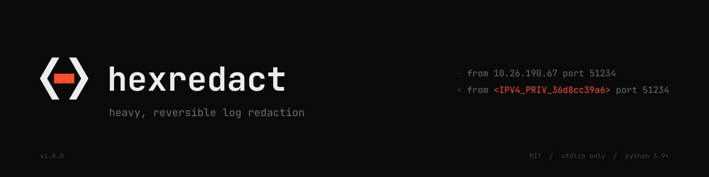

<p align="center">
  <picture>
    <source media="(prefers-color-scheme: dark)" srcset="assets/banner-dark.svg">
    <source media="(prefers-color-scheme: light)" srcset="assets/banner-light.svg">
    
  </picture>
</p>

# hexredact

Heavy, reversible redaction of PII, secrets and infrastructure identifiers in log files.

Point it at a log file or a directory of logs. It writes a redacted copy you can share, keeps an untouched original, and records a reverse map so every redacted value can be looked up again later.

```
- Oct 23 10:15:02 web01 sshd[2211]: Accepted publickey for alice from 10.26.190.67 port 51234 ssh2
+ Oct 23 10:15:02 <HOST_b2b891b37f> sshd[2211]: Accepted publickey for <USER_5129443114> from <IPV4_PRIV_36d8cc39a6> port 51234 ssh2
```

- **Heavy by default.** 31 detectors: IPs, hostnames, users, emails, phones, cards, national IDs, API keys, tokens, passwords, PEM blocks and more.
- **Reversible.** Values become keyed HMAC tokens. The same value always gets the same token, so you can still follow one IP or user through the logs. The map turns tokens back into values.
- **Accurate.** Phone numbers are never confused with IP addresses. Timestamps, versions, epochs, ports and stack traces are left alone.
- **No dependencies.** Pure Python 3.9+ standard library. Linux, macOS and Windows.

## Install

```bash
pipx install git+https://github.com/happygream/hexredact
# with encrypted reverse maps:
pipx install "hexredact[crypto] @ git+https://github.com/happygream/hexredact"
```

Or `pip install .` from a clone. You can also run it without installing: `python -m hexredact` from `src/`.

## Quick start

```bash
hexredact                                # interactive wizard
hexredact scan /var/log/nginx --show 10  # dry run with a before/after sample; writes nothing
hexredact redact /var/log/nginx          # do it
```

## Output layout

| Input | Output |
|---|---|
| `logs/` | `logs_original/`: untouched copy, plus `redaction_map.json` |
| | `logs_redacted/`: redacted tree, plus `redaction_report.txt` and `.json` |
| `app.log` | `app_original.log`, `app_redacted.log`, `app_redaction_map.json`, `app_redaction_report.txt` |

- The original is preserved before anything is redacted. `--move` renames the source instead of copying it, which helps with large log directories.
- Existing outputs are never overwritten unless you pass `--overwrite`.
- Directories are processed recursively: `.log .txt .out .err .json .jsonl .csv .trace` plus rotated `*.log.1` and `.gz` files. Binary files are skipped.

## Modes

**Token mode (default).** Each value becomes `<CATEGORY_hmac>`, for example `<IPV4_PUB_c516780798>`.

- **Random key (default):** tokens are unique to that run.
- **Passphrase** (`--passphrase-env VAR`, `--passphrase-file F`, `--ask-passphrase`): the same passphrase gives the same tokens across runs. Use this to correlate separate batches of logs without revealing values.
- **The map** is written with mode `0600`. Encrypt it with `--encrypt-map` or `--map-passphrase-env VAR` (scrypt + Fernet; needs the `[crypto]` extra).

**Mask mode** (`--mode mask`). Values become `[REDACTED:IPV4_PRIV]`. No map is written and nothing can be recovered.

## Getting values back

```bash
hexredact lookup logs_original/redaction_map.json '<IPV4_PUB_c516780798>'
grep -o '<[A-Z_]*_[0-9a-f]*>' incident.txt | hexredact lookup logs_original/redaction_map.json
hexredact restore logs_original/redaction_map.json logs_redacted/       # -> logs_restored/
```

If the same value was written two ways, such as `(555) 123-4567` and `555-123-4567`, both share one token. A restore writes the first form seen, and the map lists the other forms under `variants`. The `_original` copy is always exact.

## Pipes

```bash
journalctl -b | hexredact redact - --map boot.map.json > boot.redacted.log
kubectl logs pod/api | hexredact redact - --mode mask | less
```

UI output goes to stderr, so stdout carries only the redacted text.

## What is detected

Run `hexredact detectors` for the full ordered list. Select a subset with `--only a,b` or turn detectors off with `--disable a,b`.

| Group | Detectors |
|---|---|
| Secrets | Authorization and Cookie headers, JWTs, AWS/GitHub/Slack/Stripe/Google/GitLab/OpenAI/Anthropic/npm keys, bearer tokens, `password=` / `token=` / `api_key=` style values, `user:pass@` in URLs, PEM private keys and certificates, every URL query value |
| People | emails, phones (UK, US, international), payment cards (Luhn and issuer checked), IBANs (mod-97 checked), UK NI numbers, US SSNs, UK postcodes, lat/long |
| Network | IPv4 and IPv6 (validated, tagged `PUB`/`PRIV`/`RSVD`, ports and CIDR kept), MAC addresses, FQDNs, UNC hosts |
| Identity | syslog hostnames, `host=` / `user=` fields, sshd/sudo/PAM users, `DOMAIN\user`, `/home/<user>`, Windows SIDs, AWS account IDs |
| IDs | UUIDs, long hex strings (hashes, session IDs), long base64 blobs |

### Two passes

1. **Learning.** The first pass collects hostnames and usernames from strong contexts: syslog headers, `host=`, `Accepted publickey for alice`, and similar. Once `web01` is learned, every bare mention of `web01` anywhere in the logs gets the same token. Common words like `root`, `admin` and `api` are never propagated.
2. **Redaction.** Detectors run in a fixed order. Each hit is immediately replaced with an opaque placeholder, so no later detector can match its characters again. This is how phones and IPs are kept apart: IPs run long before phones, and the phone patterns accept only strict shapes.

After writing, a **residual scan** checks the output again and reports anything still detectable. `--strict` makes that a non-zero exit, which is useful in CI.

### Your own terms

People's names and company or project names can't be found by pattern. Supply them:

```bash
hexredact redact logs/ --terms "Jane Doe,Acme Ltd,project-falcon" --terms-file names.txt
```

The machine's hostname and current username are added automatically. Turn that off with `--no-auto-terms`. Use `--allow` for values that must never be redacted.

## Exit codes

| Code | Meaning |
|---|---|
| `0` | success |
| `1` | error, or a token not found by `lookup` |
| `2` | usage error |
| `3` | residual items found with `--strict` |

## Security notes

- The reverse map and the `_original` output contain the real data. Treat them as sensitive and share only `_redacted`.
- Token mode is pseudonymisation, not anonymisation. Anyone with the key or map can reverse it, and token frequency is still visible. Use `--mode mask` when the output must be irreversible.
- Pattern-based redaction can miss things. Check the residual scan and run `scan --show` on new log formats before sharing output widely.

See [SECURITY.md](SECURITY.md) for reporting issues.

## Development

```bash
pip install -e ".[dev,crypto]"
pytest -q && ruff check .
```

## License

MIT
